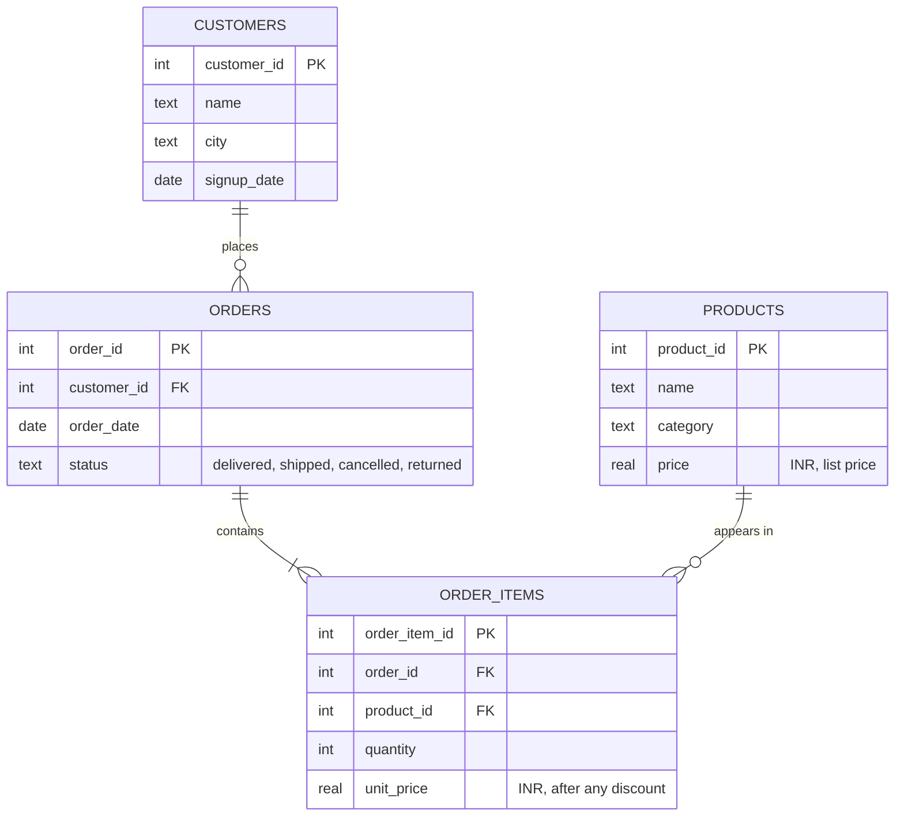

# Natural-Language Data Query Agent

Ask questions about a database in plain English. An LLM agent looks up the schema, writes SQL,
runs it, fixes its own mistakes, and answers in a sentence, showing the SQL it used.

**Database:** a sample SQLite retail database (`data/retail.db`) with 200 customers, 26 products
and 1,500 orders, with prices in INR. See [Sample data](#sample-data) for the full schema.

```
> Which month in 2025 had the highest revenue?

Answer: November 2025 had the highest revenue, at INR 246,598.80.

SQL used:
  SELECT strftime('%Y-%m', o.order_date) AS month,
         ROUND(SUM(oi.quantity * oi.unit_price), 2) AS revenue
  FROM orders o JOIN order_items oi ON oi.order_id = o.order_id
  WHERE o.status NOT IN ('cancelled', 'returned') AND strftime('%Y', o.order_date) = '2025'
  GROUP BY month ORDER BY revenue DESC LIMIT 1
```
*(Illustrative output. The exact wording depends on the model.)*

## How it works

The agent is a tool-calling loop built with LangChain's `create_agent`. The LLM gets three tools
and decides which one to call next until it can answer:

| Tool | What it does |
|---|---|
| `list_tables` | Lists the tables in the database |
| `describe_tables` | Returns the `CREATE TABLE` statement plus 3 sample rows for each table asked for |
| `run_sql` | Validates and runs one SELECT query; returns rows, or the error text so the model can retry |

```
question ─► LLM ─► list_tables ─► describe_tables ─► run_sql ─┐
                                                   ▲          │ error?
                                                   └──────────┘ fix and retry
                                                   rows ─► LLM ─► plain-language answer
```

**Safety (read-only by design):**
1. The SQLite connection is opened in read-only mode, so writes fail at the database level.
2. Every query is parsed with `sqlglot` first: one statement only, and it must be a SELECT.
   `DROP`, `DELETE`, `UPDATE`, `PRAGMA`, `ATTACH` and similar are rejected.
3. Results are capped at 50 rows and slow queries are stopped after 5 seconds.
4. Errors go back to the model as text instead of crashing, which is what makes self-correction work.

**Prompt engineering:** the system prompt tells the model to inspect the schema before writing SQL,
defines business terms (for example, revenue excludes cancelled and returned orders), explains the
date format, and asks it to say so when a question can't be answered from the data.

## Sample data

`data/create_db.py` builds `data/retail.db`, a small retail database with reproducible random data:

| Table | Rows | Columns |
|---|---|---|
| customers | 200 | customer_id, name, city, signup_date |
| products | 26 | product_id, name, category, price |
| orders | 1,500 | order_id, customer_id, order_date, status |
| order_items | ~2,600 | order_item_id, order_id, product_id, quantity, unit_price |

How the tables connect:



Each customer can place many orders, each order has one or more items, and each item refers to
one product. About 7% of customers have signed up but never ordered.

You can point the agent at any SQLite file with `--db path/to/file.db`.

## Setup

```bash
python -m venv venv
source venv/bin/activate            # Windows: venv\Scripts\activate
pip install -r requirements.txt

cp .env.example .env                # Windows: copy .env.example .env
# open .env and paste your API key

python data/create_db.py            # creates data/retail.db
python -m pytest -q                 # tests run without an API key
```

The default model is `openai/gpt-oss-120b` on Groq, which has a free tier. To use Gemini instead,
`pip install langchain-google-genai`, set `GOOGLE_API_KEY` and `MODEL=google_genai:gemini-2.5-flash`
in `.env`. Model names change often; check the provider's current model list if one is rejected.

## Usage

```bash
python app.py                                         # interactive chat
python app.py "What is the revenue for each category?"
python app.py --model google_genai:gemini-2.5-flash   # pick a different model
```

## Evaluation

`eval/questions.json` has 15 questions (5 easy, 6 medium, 4 hard), each with a hand-written
correct ("gold") SQL query. The evaluation runs the agent on each question and compares the
**result** of its SQL with the result of the gold SQL (execution accuracy). Column order, row
order, extra columns and small rounding differences are ignored.

```bash
python -m eval.run_eval                 # all questions
python -m eval.run_eval --sleep 3       # pause between questions if you hit rate limits
```

It prints accuracy overall and by difficulty and saves every question, the agent's SQL and
pass/fail to `eval/results.csv`.

| Model | Easy | Medium | Hard | Overall |
|---|---|---|---|---|
| _fill in after running_ | | | | |

## Project structure

```
agent/
  sql_tools.py    database access, SQL validation, the three tools
  core.py         system prompt, agent setup, SQLAgent.ask()
data/
  create_db.py    builds the sample database
eval/
  questions.json  test questions with gold SQL
  run_eval.py     execution-accuracy evaluation
tests/            unit tests (no API key needed)
app.py            command-line interface
```

## Ideas for next steps

- A Streamlit web interface that shows the answer, SQL and a chart of the result
- Conversation memory for follow-up questions ("now only for Pune")
- Retrieving only the relevant tables when the database has many
- PostgreSQL support via a read-only database user
